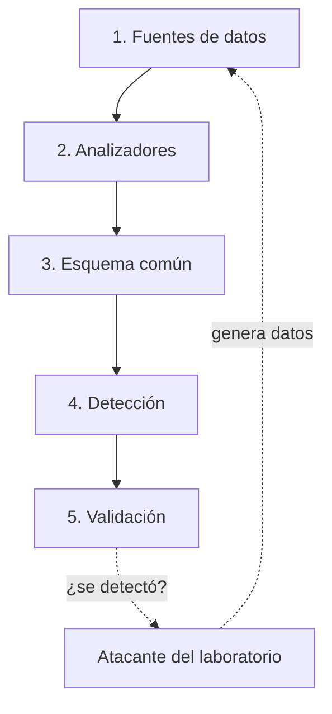

# Arquitectura

## Visión general

Las herramientas del ecosistema se conectan a través de un **formato común de hallazgos** en JSON. Cada herramienta lee una fuente de datos y produce hallazgos con el mismo esquema, de modo que otra herramienta (un SIEM, un informe o el validador) puede consumirlos sin adaptaciones.

| Capa | Contenido |
| --- | --- |
| 1. Fuentes de datos | Logs de Linux y Windows, correos, Active Directory |
| 2. Analizadores | authwatch, phish-triage, ad-hygiene |
| 3. Esquema común | Hallazgos en JSON con el formato `o2.finding` |
| 4. Detección | Reglas Sigma y el SIEM Wazuh del laboratorio |
| 5. Validación | purple-validator: qué ataques se detectaron y cuáles no |
| Atacante del laboratorio | Máquina Kali que simula técnicas de MITRE ATT&CK |

El bucle de la derecha es la parte Purple Team: se simula una técnica de ataque en el laboratorio, los datos que genera pasan por las herramientas, y el validador comprueba si alguna detección la vio.

## Decisiones

### 1. Arquitectura híbrida de repositorios

- **Decisión:** este repositorio central explica el conjunto; cada herramienta importante tiene su propio repositorio.
- **Alternativas descartadas:**
  - Un único repositorio para todo: fácil de mantener, pero el trabajo queda escondido en carpetas y mezcla lenguajes y versiones en un mismo ciclo.
  - Solo repositorios sueltos: cada herramienta es independiente, pero no se ve la visión de conjunto ni hay un lugar para el esquema común.
- **Coste aceptado:** más repositorios que mantener y el esquema hay que mantenerlo sincronizado.

### 2. Esquema común de hallazgos

- **Decisión:** todas las herramientas pueden producir JSON con el esquema `o2.finding`, versionado en la carpeta `schema/` de este repositorio.
- **Motivo:** permite encadenar herramientas, enviar hallazgos a un SIEM y medir cobertura de forma uniforme.
- **Coste aceptado:** cambiar el esquema obliga a revisar todas las herramientas. Por eso está versionado (`v0`, `v1`...) y una versión publicada no cambia.

### 3. Datos sintéticos

- **Decisión:** todos los ejemplos y tests usan datos inventados de un hospital ficticio (`hosp.lab`, equipos `HOSP-WS-xxx`, IPs de documentación como `203.0.113.0/24`).
- **Motivo:** los datos reales de cualquier organización son confidenciales. Las IPs de documentación (RFC 5737) no pertenecen a nadie.

### 4. Laboratorio local

- **Decisión:** laboratorio en VirtualBox con red interna aislada.
- **Máquinas previstas:** SIEM (Ubuntu + Wazuh), controlador de dominio (Windows Server 2022), puesto Windows 11 con Sysmon, servidor Linux y Kali como máquina atacante.
- **Motivo:** permite practicar ataques y detección sin tocar redes ajenas. Las instantáneas permiten volver a un estado limpio en segundos.
